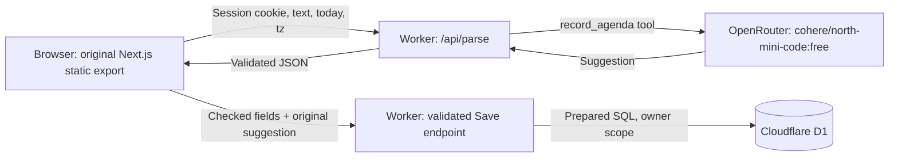

# Хмарна демонстрація без AWS-запитів

Оновлення: тепер за цією адресою розміщено **оригінальний Next.js frontend**
із `frontend/`: Home, Board, Meetings та попередній редактор Agenda.
Окремі HTML/CSS/JS демосторінки видалено. Основні API адаптовано до D1:
задачі CRUD/status, зустрічі CRUD, статистика, agenda й AI-пропозиції.
Безкоштовний вхід лишається за паролем одного власника; звіт завантажується
як CSV замість email через AWS. Історичні AWS-дані не переносилися.
Перевірка: `docs/ai-evidence/cloudflare-original-ui-check.json`.

Адреса: https://peach-agenda-free.peach-free-cloud-demo.workers.dev/

Це безкоштовний варіант Peach на Cloudflare Workers і D1
з оригінальним інтерфейсом. Дані AWS не копіювалися. Браузер, parser і Save
у цій версії не звертаються до AWS. Наявні AWS-ресурси не змінені та не видалені;
їхні попередні витрати можуть продовжуватися незалежно від цієї демонстрації.

## Вхід і запис відео

Пароль — значення `CLOUDFLARE_DEMO_PASSWORD` у локальному `.env`.
Пароль, SESSION_SECRET і OPENROUTER_API_KEY передані лише в Worker Secrets.
Їх немає у статичних файлах, репозиторії та цій інструкції.

1. Відкрити сайт і ввійти за паролем демонстрації.
2. Відкрити Meetings, створити зустріч або знайти наявну; натиснути Agenda.
3. Почати запис (на Mac: Cmd+Shift+5).
4. Вставити навчальний текст, натиснути Parse, дочекатися suggested-полів.
5. Змінити одне поле, наприклад 15 → 20 хв, і натиснути Save agenda.
6. Показати «Agenda збережено». Відео має тривати не більше 45 секунд.

## Архітектура й обмеження



- Вхід особистої демоверсії: один власник, HttpOnly Secure SameSite cookie,
  HMAC-підпис і строк дії 12 годин. Це не Cognito й не багатокористувацький SaaS.
- JSON-схема й версія промпта взяті з Python-реалізації. Відповідь перевіряє Ajv;
  допустима одна repair-спроба. Модель не записує дані в D1.
- Перевірка origin для змін даних, обмеження 10 000 символів, серверний ключ.
- Дозволена тільки конкретна модель з `:free`; платного fallback немає.
- Ліміт демонстрації: 40 inference-спроб на добу (repairs теж рахуються).
  OpenRouter може застосувати меншу залишкову квоту всього акаунта.
- Вичерпання квоти повертає помилку; ручне введення та Save залишаються.
- Cloudflare Worker logs містять user, model, prompt_version, tokens, latency,
  cost_usd і status; не містять pasted text, пароля або API key.
- Це Cloudflare-логи, а не CloudWatch. Умова лаби прямо вимагає Claude/Bedrock;
  відхилення треба погодити з викладачем.

Платні Cloudflare-підписки та AWS-операції деплою не запускалися. Worker/D1
використовуються в межах Free; квоти платформи залишаються чинними.
API підписок недоступний поточному OAuth-token (403), тому перевірка самого
тарифу через Billing API не виконана; платний план кодом не підключався.

## Джерела та відтворення

Код інтерфейсу: `frontend/`. API: `cloudflare/worker.js` і `cloudflare/v1.js`.
Конфіг: `cloudflare/wrangler.jsonc`. Міграції: `cloudflare/migrations/`.
Secrets не додавати у конфіг. Пароль та Worker Secrets залишилися ті самі.

```bash
cd frontend
pnpm install --frozen-lockfile
cd ../cloudflare
npm ci
npm test
npm run deploy
```

При повторному деплої перевірити Free-план у своєму Cloudflare dashboard.
Не вмикати платні Workers, AI, R2 чи інші підписки для цієї демонстрації.
