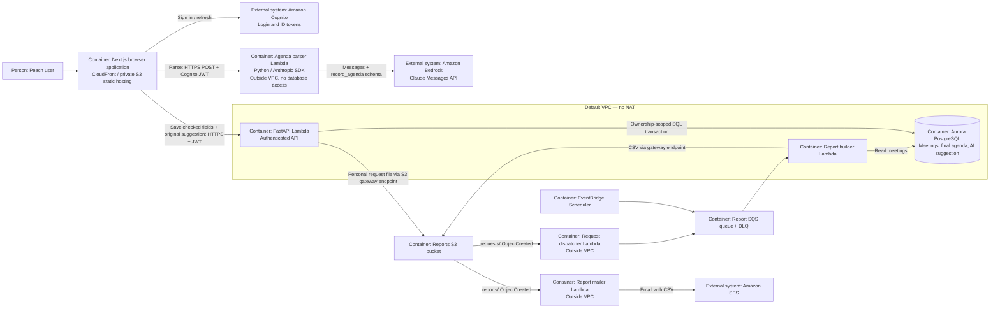
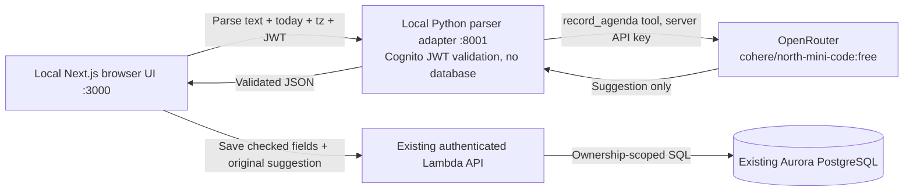

# Peach — container diagram (C4 level 2)

Only the parse path calls a model. Only the trusted API saves the checked agenda. Existing weekly reports keep their separate event-driven path.

## Optional free cloud demonstration (2026-10-28)

The owner requested no paid inference and no local model weights. The local
Next.js UI can instead call a loopback Python adapter, which verifies Cognito
and invokes `cohere/north-mini-code:free` through OpenRouter. Its server-side
API key is never sent to the browser. Only this free model and the free router
are allowed; quota exhaustion returns an error, without a paid fallback.
Save still uses the existing authenticated API. This alternative has not been
deployed to AWS and does not replace the assignment's Bedrock requirement.

Actual API measurements and semantic failures are recorded in
`docs/ai-evidence/FREE_EVALUATION.md`. No authenticated UI recording or
CloudWatch evidence is claimed for the local alternative.
