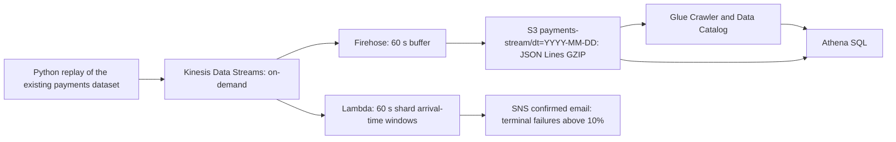

# Lab 8 — real payments, batch and streaming

The owner permits **free work only**. No Athena, Glue, Kinesis, Firehose or SNS
resources/queries were executed. AWS outputs/screenshots/crawler findings and
cloud costs must not be invented. Local results are explicitly one real day,
not the full October dataset. The original Peach application and migrated
Terraform workspace are unaffected; `cloud/` is a separate, undeployed root.

## Reproduce local streaming

Prerequisites: Python **3.13**, Docker Desktop, Compose. On this Mac Docker is
`/Applications/Docker.app/Contents/Resources/bin/docker`; add that directory to
PATH so its credential helper works. The official single-broker example is at
https://docs.redpanda.com/labs/docker-compose/single-broker/ . Images are pinned.

From the repository root:

```sh
uv venv --python 3.13 .local/lab8/venv
uv pip install --only-binary :all: --python .local/lab8/venv/bin/python -r labs/lab8/requirements.txt
.local/lab8/venv/bin/python labs/lab8/download_day.py --output .local/lab8/events.jsonl
docker compose -f labs/lab8/compose.yml up -d --wait
docker compose -f labs/lab8/compose.yml exec redpanda rpk topic create payments --partitions 3
.local/lab8/venv/bin/python labs/lab8/consumer.py --state .local/lab8/manual.db
```

In another terminal:

```sh
.local/lab8/venv/bin/python labs/lab8/producer.py .local/lab8/events.jsonl
```

Default pacing averages 20 distinct payments/s across the webhook replay; the
webhook rate is ~60 events/s. Received-time ordering is preserved, but gaps are
compressed. `invoiceId` is the Kafka key. Console: http://localhost:8080 .

Run `experiments.py` on a fresh broker (topics must not already exist):

```sh
.local/lab8/venv/bin/python labs/lab8/experiments.py .local/lab8/events.jsonl \
  --work .local/lab8/experiments --out docs/lab8-evidence
```

It really stops a consumer for **60 seconds**, while the producer continues.
All five recorded experiments replay faster than real time (`--payments-per-second 0`)
to save time; original modifiedDate/receivedAt values remain unchanged. This
is disclosed in every summary, not presented as a timed 20-payments/s capture.
Each window CSV contains the consumer output, including alerts. Topic variants
isolate experiments. Raw process logs and SQLite databases are ignored.

## Window semantics and recovery

Exact duplicates are SHA-256 hashes of canonical complete JSON records. A
one-minute bucket is `[floor(modifiedDate/60)*60, start+60)`. The watermark is
**minimum of the maximum observed modifiedDate in each active partition minus
120 seconds**. It never uses the laptop clock. A record is rejected when its
window end is <= the previous watermark. Idle partitions conservatively hold
the watermark; production needs an explicit idle-partition policy. Finite
replay ends with one control marker per partition, after delivery of all data.
These markers close remaining windows; they are not payment events.

`failure_rate` is failures/(success+failure), counting terminal webhook outcomes
per method/window. This avoids diluting a payment-failure alert with created and
processing statuses. The CSV also exposes failure/all-events to make the
choice explicit. Batch analytics selects one latest state per invoice, so its
denominator is different from the event-time stream's terminal outcomes.

Both consumers share one SQLite WAL state file **on this laptop**. Each event's
state, dedup hash and partition next-offset checkpoint commit atomically. On
assignment, a worker seeks to that checkpoint, so a crash between SQLite and
Kafka offset commits cannot lose or double-count its effects. SQLite serializes
writers, preventing split workers from raising partial-partition aggregate
alerts. This is a single-host demonstration, not a distributed production
state backend. Kafka delivery remains at-least-once; console output can be lost
if a process crashes just after state commit. Production alerts need an outbox.

The seen set grows without bound for this finite dataset. In production retain
state in Flink/Redis with a TTL covering lateness + recovery/replay horizon;
evicting fingerprints too early makes redelivery count again. Persist Kafka
checkpoints and stream state together. Rebalance assignments are in evidence.

## Batch

`sql/athena.sql` contains the external JSON table, partitions, exact-event view,
latest-invoice view, scale/late queries, turnover, failure rate, peak hours and
Parquet CTAS. Replace `${DATABASE}` and `${BUCKET}` only after cloud cost approval.
Use the same exact SQL queries 3–5 against `payments_parquet` after CTAS.
Dates use ISO-8601 parsing, amounts use minor units/100, currencies stay separate,
and peak hours are explicitly Europe/Kyiv (including October DST changes).

The owner must first copy the full `payments/` prefix into an OWN bucket for
real AWS execution. This has not been done. Run a crawler separately with a
different table prefix; inspect actual amount/ccy/date types, dt partitions and
failureReason before writing answers. Missing sparse fields are a crawler
observation, not something that can be asserted without running one.

Free local cross-check:

```sh
.local/lab8/venv/bin/python labs/lab8/local_analytics.py .local/lab8/events.jsonl \
  --out docs/lab8-evidence/local-batch
```

`local-batch/*.csv` are DuckDB results for October 1, not Athena exports. Athena
DataScannedInBytes, query runtimes and JSON/Parquet cost ratios are **not measured**.
The full-month invoice/duplicate/late figures are also not inferred from one day.

## Cloud design — prepared, NOT deployed



`cloud/main.tf`, `cloud/producer.py`, `cloud/alert.py` and the SVG diagram define
the separate cloud pipeline. The cloud producer refuses execution without
`--allow-paid-aws`. No apply command is provided/run. Before an approved deploy,
zip alert.py as alert.zip (ignored), set account_id/alert_email, and review plan.
Confirm the SNS subscription email manually. Firehose data are newline-delimited;
only after objects arrive run the crawler and then `stream-query.sql` against
its actual table. Late original timestamps do not change Firehose's arrival-day
partition. This differs from original dataset event-day partitions.

The Lambda variant uses AWS-managed per-shard **arrival-time** tumbling windows;
it is deliberately NOT claimed to have the same global event-time semantics
as the local consumer. Its returned window state dedups only within that window,
with a guard on state size. For cross-shard event-time windows, use Flink or a
shared durable store plus an outbox. SNS deliveries can be duplicated.

Costs: actual new cloud resources/queries = **none**; actual lab cloud spend =
$0 from no execution, not a claim the services are free. Athena charges for
scanned bytes; Glue crawler compute and Kinesis/Firehose are chargeable.
Official references: https://aws.amazon.com/athena/pricing/ ,
https://aws.amazon.com/glue/pricing/ ,
https://aws.amazon.com/kinesis/data-streams/pricing/ .

After any separately approved cloud run, stop/delete Firehose before Kinesis,
stop/remove the crawler and Lambda event source, and remove demo subscriptions,
roles, logs and workgroup when safe. Export evidence first. S3 files may need
explicit deletion before removing its bucket; the Terraform bucket does NOT
force-delete data. Current owner instruction forbids this cloud run.

## Cleanup only this lab

```sh
docker compose -f labs/lab8/compose.yml down -v
```

After exporting evidence, remove only `.local/lab8` and the two lab-pulled images
if unused. Do not run docker system prune or touch the Peach app's volumes.
Do not leave Redpanda running in the background after collecting evidence.
