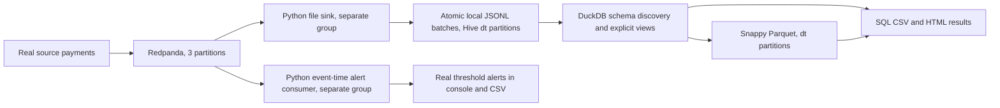

# Free local replacement: actual monthly batch + stream-to-files + SQL

This is the owner-authorized replacement for chargeable AWS execution. It uses
real Redpanda, Python and DuckDB. It does NOT emulate AWS or claim an Athena/
Glue screenshot. Instructor acceptance of this substitution is still required.

## Run from the repository root

Prerequisites: existing Docker Desktop/Compose, Python 3.13 and uv. No AWS login,
AWS keys, paid API key or cloud resources are needed. Public dataset reads use
HTTPS; they do not upload or create resources in your AWS account.

```sh
uv venv --python 3.13 .local/lab8-free/venv
uv pip install --only-binary :all: --python .local/lab8-free/venv/bin/python -r labs/lab8/requirements-local.txt
.local/lab8-free/venv/bin/python labs/lab8/replacement/download.py --out .local/lab8-free/raw --days 31
.local/lab8-free/venv/bin/python labs/lab8/replacement/analytics.py \
  --raw .local/lab8-free/raw --curated .local/lab8-free/curated \
  --out docs/lab8-replacement/monthly-batch --scope 'Full October 2026, 31 real days; local DuckDB'
```

The downloader compresses while reading, in three threads with 1 MiB chunks:
about 1.2 GB uncompressed becomes ~127 MiB of temporary gzip files. No generator
is used. SHA-256 hashes refer to original uncompressed objects. DuckDB uses a
512 MiB memory limit and a temporary spill directory. Both data and spill files
are removed after evidence export; they never enter Git.

The analytics script infers schema over ALL records (including sparse fields),
creates an explicit typed JSON view, exact-deduplicates, ranks latest states per
invoice, writes Snappy Parquet partitioned by dt, checks row parity both ways,
and runs turnover/failure/peak-hour queries against BOTH formats. Actual SQL,
CSVs, schema comparison, profiling JSON and a readable HTML report are exported.
One timed run per query is measured; OS caches are not reset. Profiler byte/
operator counters are diagnostics, not an Athena scan-cost surrogate.

Start Redpanda and run the free substitute for the cloud pipeline on one day:

```sh
docker compose -f labs/lab8/compose.yml up -d --wait
.local/lab8-free/venv/bin/python labs/lab8/replacement/replay_pipeline.py \
  --file .local/lab8-free/raw/dt=2026-10-01/events.jsonl.gz \
  --work .local/lab8-free/stream --out docs/lab8-replacement/stream
```

Use a fresh `payments-replacement` topic and empty work directory for a new
experiment; the runner refuses topic creation conflicts instead of mixing runs.
The finite replay is accelerated; timestamps and original records are preserved.
Default producer pacing is still 20 payments/s in `producer.py`.

## What the replacement really does



The sink preserves raw duplicates, buffering until **60 seconds OR 1 MiB OR
finite end-of-stream**. The real accelerated run exercised size/end flushing;
it is not claimed every batch waited 60 seconds. Each partition's batch is
written into a temporary directory, file hashes/manifests are fsynced, and the
whole directory is atomically renamed before committing Kafka offsets. On
restart completed batches determine next offsets; partial directories cannot
advance a checkpoint. A writer lock prevents two CLI processes writing the same
lake. This is a single local sink, not a distributed exactly-once object store.

Directories contain `partition` and `batch` bookkeeping keys, plus `dt` business
date. SQL explicitly projects only event columns + dt, so bookkeeping does not
prevent exact duplicate removal. Source/sink canonical record MULTISETS are
compared, preserving duplicate multiplicity; a row count alone is insufficient.
The three finite control markers are not saved as payments.

Alerts run in a different Kafka group, so both groups receive every message.
Within the alert group, partition assignments/checkpoints/window state use the
same durable SQLite implementation as the five earlier experiments. Window
semantics are modifiedDate event time with two-minute allowance; unlike the
prepared AWS Lambda example, they are not shard arrival-time windows. External
console notifications still need a durable outbox for production exactly-once
side effects. No emails or SNS calls are made.

After replay, DuckDB queries the actual FILE-SINK output, not the original source
file. It then makes and queries Parquet from that output. `pipeline.json`
records the source/sink match and checkpoint restoration; the six new file-sink
unit tests cover persisted batches, unflushed replay, partial directories,
corruption, offset gaps and control markers.

## Evidence and cleanup

Open `docs/lab8-replacement/monthly-batch/report.html` for full-month batch SQL.
Open `docs/lab8-replacement/stream/sql/report.html` for SQL over data actually
received through the stream. Screenshot the latter if the instructor accepts a
DuckDB replacement screenshot. Its heading explicitly identifies local DuckDB.
The five original Part 3 experiments remain in `docs/lab8-evidence/`.

```sh
PYTHONPATH=labs/lab8 .local/lab8-free/venv/bin/python -m unittest discover -s labs/lab8/tests
docker compose -f labs/lab8/compose.yml down -v --rmi all
```

After copying evidence, remove ONLY `.local/lab8-free` (this lab's dependencies,
source copies, broker-independent state and Parquet). Never use a global Docker
prune or delete the Peach application's volumes. Reinstallation/replay remains
possible from the committed source and pinned requirements.

Reference for real local Hive partition discovery:
https://duckdb.org/docs/stable/data/partitioning/hive_partitioning.html
No AWS service was run. All JSON/Parquet runtimes here are actual local timings;
new cloud charges for this replacement are $0 because it creates none.

A separate actual timer probe is implemented in `check_timer.py` and recorded
in `docs/lab8-replacement/timer-check.json`: 10 real events were persisted after
60.265 seconds since startup, before EOS and below the 1 MiB threshold.
It can be repeated on a fresh `payments-timer-check` topic using the same one-day
gzip input. This verifies the default time trigger rather than assuming it works.
